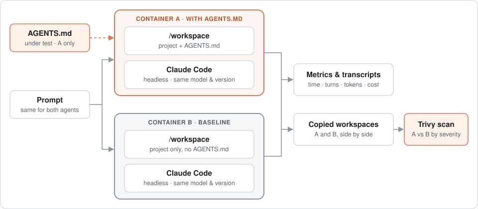
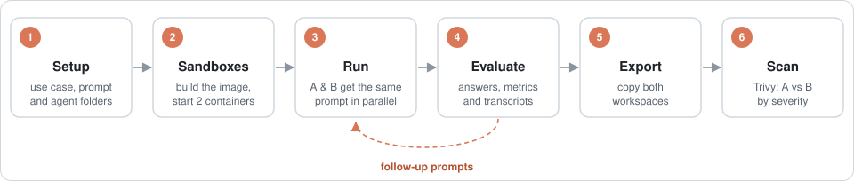

<div align="center">

# 🧪 agentsmd-ab

**Does your `AGENTS.md` actually change what a coding agent builds?**<br>
Run two Claude Code agents side by side with different instructions, such as an `AGENTS.md` against none or a full checklist against a reduced one, and compare the results.


[How it works](#-how-it-works) · [Quick start](#-quick-start) · [Agent folders](#%EF%B8%8F-agent-folders) · [Workflow](#-workflow) · [Security scan](#-security-scan-with-trivy) · [Output](#-output) · [Options](#%EF%B8%8F-options)

</div>

---

## ✨ Features

| | |
|---|---|
| 🅰️🅱️ **Controlled comparison** | The two agents share the same image, Claude Code version, model, prompts and project. The only difference is what you put in their agent folders. |
| 🐳 **Isolated sandboxes** | Each agent runs in its own Docker container on its own network. No host folders are mounted. |
| 🗂️ **Agent folders** | Give each agent its own `.claude/` folder (AGENTS.md, skills, settings, ...) from `inputs/agent_a` and `inputs/agent_b`. |
| 🆕 **New or existing projects** | Start from an empty folder, or copy an existing codebase into both workspaces. |
| 💬 **Follow-up prompts** | Send evaluation questions to both agents or to one of them. Each agent continues its own conversation. |
| 📦 **Workspace export** | Copy both workspaces to your machine to inspect or diff them. |
| 🛡️ **Trivy scans** | Find vulnerable dependencies, hard-coded secrets and misconfigurations, with A and B compared by severity. |
| 📊 **Metrics & transcripts** | See wall time, agent turns, tool calls, tokens and cost per prompt, plus full transcripts. |

## 🔍 How it works

<p align="center">
  
</p>

Each agent gets the same project plus its own agent folder, with its `.claude/AGENTS.md`, skills and so on, in the place where Claude Code reads them in real projects. Put something different in each folder and compare what the agents produce.

## 🚀 Quick start

**Requirements:** Docker running (Docker Desktop on Windows/macOS) and Python 3.12+. No pip packages are needed.

**1. Add credentials.** Run `claude setup-token`, then create `.env/claude.env`:

```env
CLAUDE_CODE_OAUTH_TOKEN=sk-ant-oat01-...
```

**2. Run the example** from [inputs/](inputs/). Agent A gets a [secure-coding checklist](inputs/agent_a/.claude/AGENTS.md), agent B gets an empty AGENTS.md, and both get the same FastAPI development prompt.

```bash
python agentsmd_tester.py --mode new --prompt-file inputs/1.develop.md --model opus
```

**3. Evaluate.** When both agents finish, use the menu to send an evaluation prompt, copy the workspaces and run a Trivy scan.

> [!TIP]
> Running `python agentsmd_tester.py` with no arguments is fully interactive. It asks for the use case, the project and the prompt, and uses the agent folders in `inputs/`.

<details>
<summary>🔑 <b>Other credential options</b></summary>
<br>

| File | Contents | Notes |
|---|---|---|
| `.env/claude.env` | `CLAUDE_CODE_OAUTH_TOKEN=...` or `ANTHROPIC_API_KEY=...` | **Recommended.** Passed to both containers with `--env-file`. |
| `.env/.credentials.json` | copy of `~/.claude/.credentials.json` after `claude login` | Used only when `claude.env` defines no token. |

OAuth refresh tokens can be used only once. When `.credentials.json` is used, the script refreshes the token once before the agents start, keeps the newest credentials in sync between the containers, and writes them back to the file.

> [!WARNING]
> If `.credentials.json` was copied from your own `~/.claude`, the token rotation can log out the Claude Code install on your machine. A `setup-token` token avoids this.

`.env/`, `*.env` and `runs/` are git-ignored.
</details>

## 🗂️ Agent folders

Everything in an agent folder is copied into that agent's workspace root, on top of the project. So `inputs/agent_a/.claude/` becomes `/workspace/.claude/` in container A, which is where Claude Code reads project instructions and skills.

```text
inputs/
├── 1.develop.md                    prompt
├── agent_a/                        → copied into agent A's /workspace
│   └── .claude/
│       ├── AGENTS.md               full secure-coding checklist
│       ├── skills/<name>/SKILL.md  project skills (optional)
│       └── settings.json, ...      anything else Claude Code reads from .claude/
└── agent_b/                        → copied into agent B's /workspace
    └── .claude/
        └── AGENTS.md               empty: no instructions
```

Common comparisons:

| Compare | Agent A folder | Agent B folder |
|---|---|---|
| AGENTS.md against none | `.claude/AGENTS.md` | empty |
| Two AGENTS.md versions | `.claude/AGENTS.md` (v1) | `.claude/AGENTS.md` (v2) |
| A skill's effect | AGENTS.md + `.claude/skills/x/` | same AGENTS.md, no skill |

- `inputs/agent_a` and `inputs/agent_b` are used by default when they exist. Use `--agent-a-dir` / `--agent-b-dir` to point at other folders, or `--no-agent-dirs` to ignore them.
- `--agents-md FILE` still works. It puts the file at the root of agent A's workspace and is optional when A's folder already has an AGENTS.md.
- At start-up the script shows which AGENTS.md each agent gets, and warns if both folders are identical.
- `.gitkeep` files are not copied. A copy of both folders is saved in each run under `runs/<run>/inputs/`.

> [!TIP]
> Put only what you want the agent to see in its folder: every file in it becomes part of that agent's workspace.

## 🔄 Workflow

<p align="center">
  
</p>

- **New project:** both workspaces start empty.
- **Existing project:** the project is copied into both workspaces, without any AGENTS.md or CLAUDE.md of its own.
- After each round a menu lets you send follow-up prompts (to both agents, A or B), copy the workspaces, run a Trivy scan or quit. Quitting removes the containers.

A session looks like this:

```text
=== Round 1: sending prompt to Agent A and Agent B ===
[Agent A] session started - model claude-opus-5-5
[Agent B] session started - model claude-opus-5-5
[Agent A] > Write: /workspace/requirements.txt
[Agent B] > Write: /workspace/main.py
[Agent A] > Bash: pip install -r requirements.txt
...
[Agent A] finished (success) - 41 agent turns, 4.2m, $0.9123
[Agent B] finished (success) - 33 agent turns, 3.1m, $0.6410

What next?
  1) Send a prompt to BOTH agents
  2) Send a prompt to agent A only
  3) Send a prompt to agent B only
  4) Copy both workspaces to the host
  5) Scan the copied workspaces with Trivy
  6) Show results summary
  7) Show the last responses again
  8) Show commands to inspect the containers yourself
  q) Quit (removes the containers)
```

<sub>Numbers are illustrative.</sub>

> [!NOTE]
> Prompts can span several lines: finish with a line containing only `.`, or type `@path/to/prompt.md` to load a file. Press **Ctrl+C** during a round to stop both agents. Their sessions are kept, so you can send another prompt afterwards.

## 🛡️ Security scan with Trivy

After you copy the workspaces, the script offers to scan them with [Trivy](https://trivy.dev). Trivy runs from the pinned `aquasec/trivy` Docker image, so you don't need to install it. Each workspace is mounted **read-only**, and the vulnerability database is cached in a Docker volume.

```text
Workspace  Kind               CRITICAL  HIGH  MEDIUM  LOW  UNKNOWN  Total
agent_a    Vulnerabilities    0         0     0       0    0        0
agent_a    Secrets            0         0     0       0    0        0
agent_a    Misconfigurations  0         0     0       0    0        0
agent_b    Vulnerabilities    0         4     4       1    0        9
agent_b    Secrets            1         0     0       0    0        1
agent_b    Misconfigurations  0         1     0       1    0        2
```

| Scanner | Finds |
|---|---|
| `vuln` | vulnerable dependencies in `requirements.txt`, `package-lock.json`, `poetry.lock`, `go.sum`, ... |
| `secret` | hard-coded tokens, keys and passwords |
| `misconfig` | issues in Dockerfiles, Kubernetes manifests, Terraform and similar files |

To scan workspaces from an earlier run (no credentials needed):

```bash
python agentsmd_tester.py --scan-only runs/<run>/workspaces/after_round_01
```

> [!IMPORTANT]
> Trivy finds dependency vulnerabilities only when versions are **pinned**, in a lockfile or with `==` in `requirements.txt`. "0 vulnerabilities" can also mean "nothing to check".

## 📁 Output

Everything is saved under `runs/<timestamp>/`:

```text
runs/20261120-105014/
├── inputs/agent_a · agent_b/      copies of the agent folders used
├── AGENTS.under-test.md          copy of --agents-md (if given)
├── prompts.md                    every prompt sent, per round
├── run.json · summary.md         per-turn metrics, final responses, Trivy counts
├── agent_a/ · agent_b/
│   ├── transcript.md             readable transcript (prompts, tool calls, responses)
│   └── turn_NN.jsonl             raw Claude Code stream-json events
└── workspaces/after_round_NN/
    ├── agent_a/
    ├── agent_b/
    └── trivy/                    JSON report per workspace + summary.md
```

## ⚙️ Options

<details>
<summary><b>All options</b></summary>
<br>

| Option | Purpose |
|---|---|
| `--agents-md PATH` | AGENTS.md under test, placed at the root of A's workspace (optional when A's folder has one) |
| `--agent-a-dir DIR` · `--agent-b-dir DIR` | [agent folders](#%EF%B8%8F-agent-folders) copied into each workspace (default: `inputs/agent_a`, `inputs/agent_b`) |
| `--no-agent-dirs` | ignore the default agent folders |
| `--mode new\|existing` · `--project DIR` | start from scratch, or copy an existing project into both workspaces |
| `--prompt TEXT` · `--prompt-file PATH` | initial prompt |
| `--model opus` | pin the model for both agents (recommended for reproducibility) |
| `--claude-version 2.1.329` | pin the Claude Code version in the image |
| `--rebuild` | rebuild the image without cache |
| `--timeout 30` | per-prompt timeout in minutes |
| `--max-turns N` | limit agentic turns per prompt |
| `--exclude NAME` | extra file/dir name not copied in (`node_modules`, `.venv`, `__pycache__`, ... are always skipped) |
| `--keep-instruction-files` | keep the project's own CLAUDE.md / nested AGENTS.md files in both copies (a root or `.claude/` AGENTS.md is always removed) |
| `--claude-md-bridge auto\|always\|never` | add `@AGENTS.md` to each agent's root CLAUDE.md (see below) |
| `--memory 4g --cpus 2` | resource limits per container |
| `--keep-containers` | keep the containers after exit (`docker exec -it <name> bash`) |
| `--quiet` · `--no-color` | don't stream live activity · plain output |
| `--scan-only DIR` | only scan previously copied workspaces with Trivy, then exit |
| `--trivy-scanners vuln,secret,misconfig,license` | choose Trivy scanners |
| `--trivy-severity CRITICAL,HIGH` | only report these severities |
| `--trivy-image aquasec/trivy:0.76.2` | Trivy image (pinned by default) |

</details>

<details>
<summary><b>How AGENTS.md reaches the agents</b></summary>
<br>

Recent Claude Code versions read `AGENTS.md` and `.claude/AGENTS.md` natively when a project has **no** `CLAUDE.md`. Each agent gets the file from its agent folder (usually `.claude/AGENTS.md`), and agent A can also get one from `--agents-md` (workspace root). Nothing else is added.

When copying an existing project, the script removes every `AGENTS.md`, `CLAUDE.md` and `CLAUDE.local.md` from **both** copies, so the only instructions are the ones in the agent folders. With `--keep-instruction-files`, those files are kept in both copies, except a root or `.claude/` AGENTS.md, which is always removed so it can't override the agent folders. Agent folders are copied after the project, so their files replace project files with the same path.

A CLAUDE.md in an agent's workspace, kept from the project or coming from its folder, would stop Claude Code from loading AGENTS.md. In that case the script adds an import (`@AGENTS.md` or `@.claude/AGENTS.md`) to that agent's root CLAUDE.md. `--claude-md-bridge always|never` overrides this.

> [!CAUTION]
> If the project is a git repository and those files are committed, an agent could still find them through git history. The script warns you when this applies.

</details>

<details>
<summary><b>Customizing the sandbox</b></summary>
<br>

Both agents use the image built from [docker/Dockerfile](docker/Dockerfile): Node 22, Python 3, git, ripgrep, build tools and Claude Code. Agents run as a non-root user with `--dangerously-skip-permissions` inside the container. Add any toolchains your projects need (Go, Rust, Java, ...) to the Dockerfile. Both agents get them.

</details>
